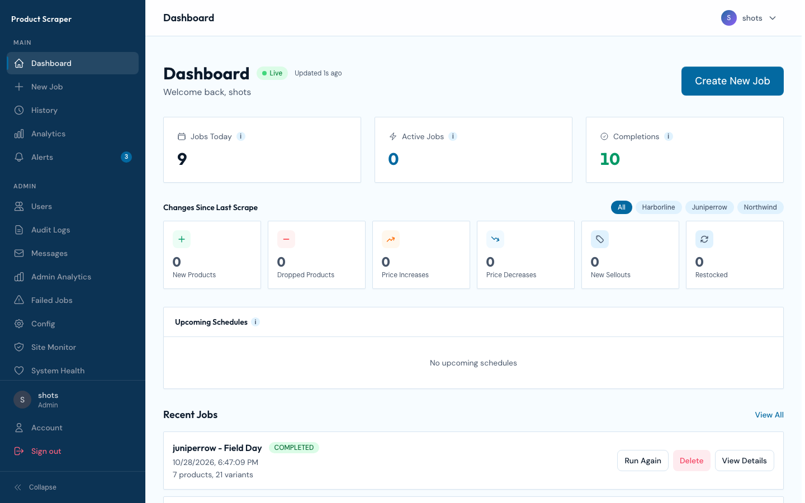
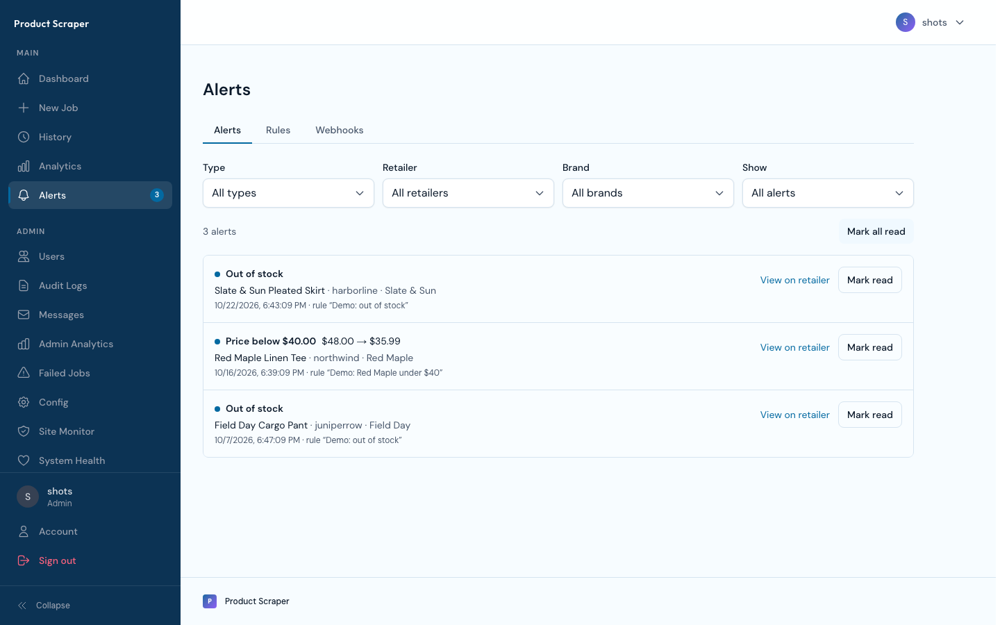
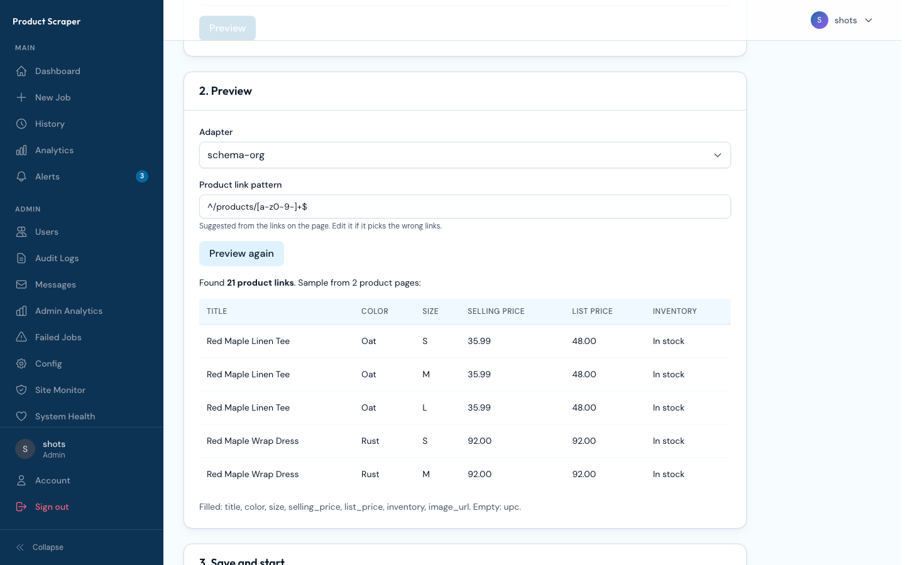

# Digital Shelf Analytics for Apparel


A self-hostable, full-stack application for tracking product variant data (colors, sizes, prices, stock) from ecommerce retailers. Built as a TypeScript monorepo — Express.js API, Next.js dashboard, BullMQ job queue — with a pluggable scraping provider.



| Alerts | Add a retailer |
|---|---|
|  |  |

The screenshots use the fictional [demo data](#demo-data). To retake them against a running demo install: `BASE_URL=http://localhost:8080 SHOT_USER=<admin> SHOT_PASS=<password> node scripts/screenshots.mjs`.

**Current version:** v1.0.0. Releases are tagged in git (`git tag --list 'v*'`).

## Retailers

No retailer is built in. The quickest way to add one is **Config → Add a retailer**: paste a brand's page on the store, preview the products and fields it finds, adjust the suggested product link pattern if needed, and save. That creates the site and brand and starts the first job. Each site uses one of these adapters:

- **`schema-org`** (the default) reads the schema.org `Product` JSON-LD that many retailers publish. It needs no code: set the site's product link pattern and a listing URL.
- **`shopify`** reads a Shopify store's public `products.json` for a collection. Detected automatically by the wizard.
- **`woocommerce`** reads a WooCommerce store's public Store API, one row per variation. Detected automatically by the wizard.
- **Your own adapter**: copy `server/src/adapters/_template.ts`, fill in `discover` and `extract`, and register it in one line.

See [docs/ADAPTERS.md](docs/ADAPTERS.md) for the adapter API. You are responsible for complying with each site's terms of use and robots.txt.

## Scraping providers

Pick how pages are fetched under **Config → Scraping provider** (admin only). Credentials are stored encrypted in the database; nothing round-trips to the browser.

- **Direct** — a local headless Chromium, optionally through your own HTTP(S) proxy
- **Apify Proxy** — route requests through Apify Proxy with your API token
- **Bright Data** — Web Unlocker (it renders JavaScript pages on its side)
- **Firecrawl** — the Firecrawl API with your API key, or your own self-hosted Firecrawl

Most large retailers block datacenter traffic, so Direct without a proxy is mainly useful for testing. Environment variables (`SCRAPER_PROXY_URL`, `BRIGHTDATA_*`) are used as a fallback until settings are saved in the UI.

## Tech Stack

| Layer | Technology |
|-------|-----------|
| **API** | Express.js, TypeScript, Zod validation |
| **Frontend** | Next.js 16, React 19, Tailwind CSS 4, Recharts |
| **Database** | PostgreSQL with connection pooling |
| **Job Queue** | BullMQ + Redis (Pub/Sub for SSE progress) |
| **Scraping** | Pluggable provider (Direct + proxy, Apify Proxy, Bright Data, Firecrawl), Playwright, Cheerio |
| **Auth** | Username/password (bcrypt) + optional OIDC single sign-on (any provider) + RBAC (admin/user roles) |
| **Logging** | Winston + Grafana Loki |
| **Process Mgmt** | Docker Compose (or PM2 by hand), Nodemon (dev) |
| **CI/CD** | GitHub Actions, Semgrep (SAST) |
| **Email** | nodemailer SMTP (admin-configurable, disabled by default; credentials AES-256-GCM at rest) |

## Project Structure

```
├── server/                    # Express.js API + BullMQ workers
│   ├── src/
│   │   ├── config.ts          # Centralized typed environment config
│   │   ├── app.ts, index.ts   # API app and process entry point (worker.ts for workers)
│   │   ├── routes/            # API route handlers (admin.ts mounts the admin sub-routers)
│   │   ├── services/          # Business logic (auth, database + migrations, queue, persistence, alerts, email, …)
│   │   ├── adapters/          # Retailer adapter API: schema-org, shopify, woocommerce and the template
│   │   ├── providers/         # Scraping providers: one module each (direct, apify, brightdata, firecrawl)
│   │   ├── scrapers/          # Page fetcher, failure types and shared HTML helpers
│   │   ├── jobs/              # Maintenance jobs (image URL backfill)
│   │   ├── middleware/        # Auth, validation, rate limiting, SSE limiting
│   │   ├── types/             # Shared TypeScript types
│   │   ├── utils/             # Logger, error helpers, JSON storage, SSE utilities
│   │   └── scripts/           # CLI scripts (create-admin, demo data, monitoring, load testing)
│   ├── data/                  # Runtime state: sites.json, brands.json, catalog caches (gitignored)
│   ├── storage/excel/         # Generated Excel reports (created at runtime)
│   └── ecosystem.config.js    # PM2 process configuration
├── client/                    # Next.js frontend dashboard
│   ├── public/                # Static files (demo placeholder images in public/demo/)
│   └── src/
│       ├── app/               # App Router pages (+ error.tsx / loading.tsx / not-found.tsx surfaces)
│       ├── components/        # UI components by area (alerts, analytics, dashboard, jobs, layout, ui, …)
│       ├── hooks/             # Custom React hooks
│       ├── lib/               # API client and utilities
│       └── providers/         # App-wide React contexts (Session, Config)
├── docker/Caddyfile           # Reverse proxy config for Docker Compose
├── Dockerfile, compose.yaml   # Images (server, web) and the self-hosted stack
├── docs/                      # ADAPTERS.md and the README screenshots
├── scripts/
│   ├── dev/                   # Local development scripts (sh + bat)
│   └── docker-env.sh          # Generates the secrets in .env for Docker
└── .github/workflows/         # CI, Semgrep, release images
```

## Run with Docker

The quickest way to run it. You need Docker with Compose v2 (Docker Desktop, or Docker Engine on Linux) and about 2 GB of free memory (the stack idles near 300 MB; page rendering during jobs uses more).

```bash
git clone https://github.com/digitalshelfanalyticstool/DSAT.git
cd DSAT
./scripts/docker-env.sh     # writes generated secrets to .env (safe to re-run)
docker compose up -d        # pulls the prebuilt images; add --build to build from source
```

The images are published to GitHub's container registry on each release. To pin a release instead of `latest`, set `APP_VERSION=1.0.0` in `.env`.

Then:

1. Get the one-time setup code: `docker compose logs api | grep "setup code"`.
2. Open http://localhost:8080/setup, enter the code, create the first admin account and pick a colour palette (admins can change it later under **Config → Appearance**).
3. Add a retailer with **Config → Add a retailer** (or by hand on **Config → Sites**, see [docs/ADAPTERS.md](docs/ADAPTERS.md)). It starts the first job.

Or, to look around first, load the demo data (see [Demo data](#demo-data)).

What runs:

| Service | Role |
|---|---|
| `proxy` | Caddy. Serves the app on one address and routes `/api` to the API |
| `web` | The Next.js dashboard |
| `api` | The Express API. Runs database migrations on startup |
| `worker` | Scraping jobs, with a headless Chromium for the Direct provider |
| `postgres`, `redis` | Database and job queue, on the internal network only |

Settings go in `.env` next to `compose.yaml`:

| Variable | Default | Purpose |
|---|---|---|
| `HTTP_PORT` | `8080` | Host port for the app |
| `SITE_ADDRESS` | `:80` | Set to a domain (e.g. `shelf.example.com`) to get automatic HTTPS. Point its DNS at this host, set `HTTP_PORT=80`, `HTTPS_PORT=443` and `COOKIE_SECURE=true` |
| `WORKER_REPLICAS` | `1` | Number of worker containers |

Data lives in Docker volumes (`pgdata`, `redisdata`, `appdata` for sites, brands and caches, `storage` for Excel files), so it survives `docker compose down` and upgrades. `docker compose down -v` deletes it.

To upgrade: `git pull && docker compose pull && docker compose up -d` (or `docker compose up -d --build` to build from source). To back up the database: `docker compose exec postgres pg_dump -U app app > backup.sql`.

### Demo data

A fictional data set for trying the app: three retailers on `.example` hosts, three brands, about 60 products with six weeks of daily prices and stock (markdowns, a sell-out, a restock, a missing image), two alert rules and the alerts they raised. Nothing is fetched from the network.

```bash
docker compose run --rm api npm run demo             # after finishing setup
docker compose restart api worker                    # so the app picks up the demo sites
docker compose run --rm api npm run demo -- --remove # delete exactly the demo data
```

It only loads into an install with no products of its own, so demo and real data never mix. From source: `npm run build:server && npm run demo -w server`.

## Prerequisites

For running from source (development). For Docker, see above.

- **Node.js** >= 20.0.0
- **PostgreSQL** (local or remote)
- **Redis** (required for job queue)
- **Chromium** for the Direct provider (`npx playwright install chromium`)
- Optionally, a proxy or a scraping-provider account (Apify, Bright Data, Firecrawl)

## Getting Started

### 1. Clone and install

```bash
git clone https://github.com/digitalshelfanalyticstool/DSAT.git
cd DSAT
npm install
```

### 2. Configure environment

Copy the example files and fill in your values:

```bash
cp server/.env.example server/.env
cp client/.env.example client/.env.local
```

**Required server variables:**

| Variable | Description |
|----------|-------------|
| `DATABASE_URL` | PostgreSQL connection string |
| `JWT_SECRET` | Signing key (min 32 chars) — generate with `openssl rand -base64 32` |
| `REDIS_URL` | Redis connection URL |
| `EMAIL_CONFIG_ENCRYPTION_KEY` | 64-char hex (32 bytes) — encrypts scraping-provider and email credentials at rest. Generate with `openssl rand -hex 32`. Must match on the API and every worker. |

The scraping provider is configured in the UI after first start (see [Scraping providers](#scraping-providers)).

**Optional:**

| Variable | Description |
|----------|-------------|
| `API_PUBLIC_URL` | Public URL of the API (default `http://localhost:3001`). The single sign-on redirect URI is built from it. |

**Required client variables:**

| Variable | Description |
|----------|-------------|
| `NEXT_PUBLIC_API_URL` | API base URL (e.g., `http://localhost:3001/api`) |

See `server/.env.example` and `client/.env.example` for the full list of optional variables (concurrency tuning, rate limits, pool sizes, Loki URL, etc.).

### 3. Start development servers

```bash
# In separate terminals:
npm run dev:server
npm run dev:client

# Or use the convenience scripts:
./scripts/dev/start-all.sh      # macOS/Linux
scripts\dev\start-all.bat       # Windows
```

The server runs on `http://localhost:3001` and the client on `http://localhost:3000`.

**First run.** A new install has no users. On start, the API logs a one-time setup code (`No users yet. Open /setup and enter this one-time setup code: …`). Open `http://localhost:3000`, which redirects to `/setup`, and enter the code with the admin's username, email and password, and pick the site's colour palette (changeable later under Config → Appearance). The code is single-use, and a restart issues a new one. Finish setup before exposing the install publicly.

**Locked out?** If no admin can sign in, run this on the server against the same `DATABASE_URL`:

```bash
npm run build:server
npm run create-admin -w server -- --username rescue --email you@example.com
```

It creates that admin, or promotes and reactivates the account with that email, and prints a one-time password that must be changed at first sign-in.

### 4. Build for production

```bash
npm run build:server
npm run build:client
```

## Available Scripts

### Root

| Script | Description |
|--------|-------------|
| `npm run dev:server` | Start server in dev mode |
| `npm run dev:client` | Start client in dev mode |
| `npm run build:server` | Compile server TypeScript |
| `npm run build:client` | Build Next.js for production |

### Server

| Script | Description |
|--------|-------------|
| `npm run dev` | Start with nodemon (auto-reload) |
| `npm start` | Run compiled production build |
| `npm run create-admin` | Create or recover an admin account (see **Locked out?** above) |
| `npm run demo` | Load the demo data; `-- --remove` deletes it (see [Demo data](#demo-data)) |
| `npm run load-test` | Run API load test |
| `npm run monitor` | Live system metrics |

## Architecture

### Multi-Process Mode

The server runs as separate API and worker processes: containers in Docker Compose, or PM2 processes (`server/ecosystem.config.js`) when run by hand.

```
┌──────────┐     ┌──────────┐     ┌──────────┐
│  Caddy   │────▶│   API    │────▶│  Redis   │
│ (proxy)  │     │          │     │ (BullMQ) │
└────┬─────┘     └────┬─────┘     └────┬─────┘
     │                │                │
┌────▼─────┐          │           ┌────▼─────┐
│ Next.js  │          │           │  Worker  │────▶ Provider
│  (web)   │          │           │          │
└──────────┘          │           └────┬─────┘
                      │                │
                 ┌────▼────────────────▼┐
                 │      PostgreSQL      │
                 └──────────────────────┘
```

`PROCESS_ROLE` picks the process: `api` (the default) serves HTTP and runs the background tasks; `worker` runs scraping, export and webhook jobs. A working install needs at least one of each.

### Scraping Pipeline

Each job follows a 5-phase pipeline:

1. **Discovery** — the site's adapter walks the brand's listing pages to find product URLs
2. **Variant Extraction** — each product page is fetched through the scraping provider, and the adapter extracts color/size/price/SKU data
3. **Retry** — Re-fetches failed products with backoff
4. **Cache Fill** — Uses cached data for products that still failed after retry
5. **Persist + Excel** — Variants saved to PostgreSQL (`product_snapshots` table), ExcelJS creates downloadable `.xlsx` reports. Before persisting, each product is classified by type from its title (`server/src/scrapers/product-type-classifier.ts`); the stored type appears as the "Type" column in the Excel export. The export excludes out-of-stock variants.

Cancelling a job, or hitting the job timeout (`JOB_TIMEOUT_MS`), stops the scrape between phases and mid-fetch. A failed or cancelled job can be continued from its last checkpoint.

Real-time progress is streamed to the dashboard via Server-Sent Events (SSE) backed by Redis Pub/Sub, with automatic REST polling as a fallback to guarantee the UI stays current even if the SSE connection silently stalls.

### Alerts

After each run is saved, enabled alert rules are checked against it: price below a set price, price drop (optionally by a minimum percent), out of stock, and broken or missing image. A rule covers everything, one brand, one retailer, or one product (a retailer plus the style ID shown in exports). A product alerts once when it starts matching a rule, and again only after it stops matching and starts again.

Alerts appear on the **Alerts** page for everyone, with an unread badge in the sidebar. Admins manage rules and webhooks there. Each webhook gets one JSON POST per run that raised alerts. Its `text` field is a readable summary, so a Slack incoming-webhook URL works as is, and with a secret set the request carries `X-Signature: sha256=<HMAC of the body>`.

### Data retention

The maintenance task (every `MAINTENANCE_INTERVAL_MS`, default weekly) drops snapshots, alerts, image checks and site-monitor runs older than `SNAPSHOT_RETENTION_DAYS`, and web-vitals data older than `WEB_VITALS_RETENTION_DAYS`. `product_snapshots` is partitioned by month and `web_vitals` by week, with UTC bounds.

### Authentication & RBAC

Two roles:

- **Admin** — Full access: user management, audit logs, system analytics, all jobs
- **User** — Self-service: own profile, own jobs, create jobs

Username and password is the default sign-in, and it stays available for everyone. Users created by an admin must replace the admin-set password at first sign-in. Logout revokes the refresh token and denylists the access token in Redis.

**Single sign-on (optional).** An admin connects any OpenID Connect provider (Microsoft Entra ID, Okta, Google Workspace, Keycloak, …) under **Config → Single sign-on**: issuer URL, client ID and secret, and the email domains allowed in. Register the redirect URI the panel shows with the provider. The sign-in page then offers "Sign in with <label>" next to the password form. On first SSO sign-in:

- an account already connected to that identity signs in;
- otherwise a non-admin account with the same email on an allowed domain is connected;
- otherwise a new `user` account is created for an allowed domain;
- an admin account is never connected by email. Admins sign in with their password and use **Connect single sign-on** on their account page.

SSO proves identity only; roles stay in the app.

Other features: account lockout protection, forced password change for admin-created users, and client-side rate limit handling with countdown timers.

### Dashboard

The main dashboard provides at-a-glance visibility:

- **Stat cards** — Jobs today, active jobs, recent completions
- **Change summary** — New/dropped products, price increases/decreases, sellouts/restocks since last scrape (filterable by retailer)
- **Upcoming schedules** — Next scheduled scraping jobs
- **Recent jobs** — Latest jobs with status, actions, and progress
- **Admin widgets** — Scraping bandwidth and cost breakdowns (admin only, shown when the active provider bills by bandwidth: Bright Data)

### Admin Pages

- **Analytics** — System health, worker utilization, phase timing, data completeness, stale products, rate limits, cost efficiency, **disk-space breakdown by file category** (excels / variant cache / logs / other), and an **Excel Reports table** for per-file admin cleanup with audit logging
- **System Health** — Real-time SSE monitoring of PostgreSQL, Redis, BullMQ and the workers (by heartbeat), with admin actions
- **Users** — User management with bulk import/export
- **Audit Logs** — Full audit trail with filtering and export
- **Site Monitor** — Detects structural changes on product pages (fetched through the scraping provider) by fingerprinting, and alerts on them. One run at a time; a run stuck longer than `SITE_MONITOR_STALE_RUN_MS` (default 2h) is marked failed
- **DLQ** — Dead letter queue inspection and retry
- **Email Settings** — Configure outbound email: pick provider (SMTP or disabled), manage encrypted credentials, send a test message, edit notification templates, inspect the send log. Credentials never round-trip to the client.

## Observability

Application logs are shipped via Winston → Grafana Loki (configurable with `LOKI_URL`). Real-time system health (PostgreSQL, Redis, BullMQ, workers) is exposed via SSE at `/api/admin/health` and rendered on the System Health admin page.

## Frontend Architecture

The client app is a Next.js 16 App Router application with a few cross-cutting pieces worth knowing about:

### Context providers (`client/src/providers/`)

- **`SessionProvider`** — Caches the authenticated session (`/auth/session`) with a 60 s stale-while-revalidate. Consumers read via `useSession()`. Revalidates on window focus after TTL expiry.
- **`ConfigProvider`** — Caches sites and brands (5 min TTL). Consumers read via `useConfig()`.
- **`KeyboardShortcutProvider`** (in `client/src/components/`) — Mounts the command palette (⌘K) and global shortcuts; reads role from `SessionProvider`.
- **`createTTLProvider<T>()`** — Generic helper that powers Session and Config. Use it for any other data source that benefits from cached + deduplicated fetches with a TTL.

### Reusable UI primitives (`client/src/components/ui/`)

All keyboard- and screen-reader-accessible out of the box. Extend these rather than adding parallel implementations:

- **`Modal`** — Native `<dialog>` with focus trap, initial-focus targeting, return-to-trigger on close.
- **`ConfirmDialog` + `useConfirm()` hook** — Branded replacement for `window.confirm()`. Use for any destructive or irreversible action.
- **`Select`** — Custom listbox with full keyboard navigation (Arrow/Home/End/Enter/Esc + typeahead), ARIA 1.2 combobox pattern.
- **`Table`** — Accessible data table. To make rows navigable, put a `<Link>` in the first column (`onRowClick` is deprecated).
- **`Breadcrumbs`** (`client/src/components/layout/Breadcrumbs.tsx`) — Wire it into deep pages for consistent navigation context.

### App Router surfaces

- **`app/error.tsx`** — Branded error boundary with Retry + dashboard link.
- **`app/loading.tsx`** — Full-page skeleton shown during slow server navigations.
- **`app/not-found.tsx`** — Branded 404.

## Deployment

Use Docker Compose (see [Run with Docker](#run-with-docker)). To run a production build by hand: `npm run build:server && npm run build:client`, then start the API and workers with PM2 (`pm2 start server/ecosystem.config.js`) and the frontend with `npm start --workspace=client`.

## API Documentation

Swagger UI is available at `http://localhost:3001/api-docs` when the server is running in non-production mode.

### Endpoint Groups

| Group | Prefix | Auth | Description |
|-------|--------|------|-------------|
| **Auth** | `/api/auth` | Mixed | First-run setup, sign-in, refresh, logout, session, account, SSO handshake |
| **Jobs** | `/api/jobs` | Bearer | Create, list, cancel, and monitor scraping jobs |
| **Downloads** | `/api/jobs/:id/download` | Bearer | Download Excel reports for completed jobs |
| **Analytics** | `/api/analytics` | Bearer | Overview KPIs, trends, change summary (latest vs previous scrape) |
| **Configuration** | `/api/config` | Bearer | Sites and brands (writes are admin), adapters, retailer preview and onboarding |
| **Scrape runs** | `/api/scrape-runs` | Bearer | Scrape run listing |
| **Alerts** | `/api/alerts` | Bearer | Alerts and mark-read for everyone; rules and webhooks (admin) |
| **Admin - Scraping provider** | `/api/admin/scraping-provider` | Bearer (admin) | Get/save the active provider (secrets masked), test a connection |
| **Appearance** | `/api/settings/appearance` | None | The site's colour palette (read-only; the setup and sign-in pages need it) |
| **Admin - Appearance** | `/api/admin/appearance` | Bearer (admin) | Change the site's colour palette |
| **Admin - SSO** | `/api/admin/sso` | Bearer (admin) | Single sign-on provider settings |
| **Data API** | `/api/data` | Bearer | Read-only access to products, variants, scrape runs, and price changes |
| **Site Monitor** | `/api/site-monitor` | Bearer | Real-time site change detection and monitoring |
| **Admin - Users** | `/api/admin/users` | Bearer (admin) | User CRUD, bulk import/export |
| **Admin - Audit** | `/api/admin/audit-logs` | Bearer (admin) | Audit log listing and export |
| **Admin - Analytics** | `/api/admin/analytics` | Bearer (admin) | System health, workers, phase timing, cost efficiency |
| **Admin - Settings** | `/api/admin/disk-space` | Bearer (admin) | Disk space (with per-category breakdown: excels, variant cache, logs, other) |
| **Admin - Reports** | `/api/admin/reports` | Bearer (admin) | List + delete generated Excel reports (`/excels`, `/excels/:jobId`). DELETE is path-traversal-gated, audit-logged, idempotent on missing files |
| **Admin - Health** | `/api/admin/health` | Bearer (admin) | Real-time system health SSE, historical snapshots, admin actions |
| **Admin - Bright Data** | `/api/admin/brightdata` | Bearer (admin) | Bandwidth usage and costs when Bright Data is the provider |
| **Admin - DLQ** | `/api/admin/dlq` | Bearer (admin) | Dead letter queue inspection and retry |
| **Admin - Messages** | `/api/admin/messages` | Bearer (admin) | Global message management |
| **Admin - Email** | `/api/admin/email` | Bearer (admin) | Provider settings (`/settings`), test-send (`/test-send`), templates (`/templates/:slug`), send log (`/log`). Credentials scrubbed from audit logs. |
| **Admin - Backfill** | `/api/admin/backfill` | Bearer (admin) | Maintenance and bulk re-scraping operations |

### Rate Limits

| Endpoint | Limit | Window |
|----------|-------|--------|
| General API (`/api/*`) | 500 requests | 15 minutes |
| Auth login | 20 requests | 15 minutes |
| Token refresh | 30 requests | 15 minutes |
| Admin (`/api/admin/*`) | 300 requests | 15 minutes |
| Email test-send (`/api/admin/email/test-send`) | 5 requests | 1 minute per user |

Rate limits are configurable via `RATE_LIMIT_API_MAX`, `RATE_LIMIT_AUTH_MAX`, `RATE_LIMIT_REFRESH_MAX` and `RATE_LIMIT_ADMIN_MAX`.

Scraping concurrency per retailer is separate: `RATE_LIMIT_MAX_CONCURRENT` (default 15) or `RATE_LIMIT_<SITE>_MAX_CONCURRENT`, shared by all workers through Redis. A slot held by a worker that crashes frees itself after `RATE_LIMIT_LEASE_TTL_MS`.

## Responsible use

This tool fetches public product pages. You are responsible for complying with each site's terms of use and robots.txt, and with the laws that apply to you. Keep request rates modest, and don't use it to collect personal data.

## Security

See [SECURITY.md](SECURITY.md) to report a vulnerability.

## License

[MIT](LICENSE)
